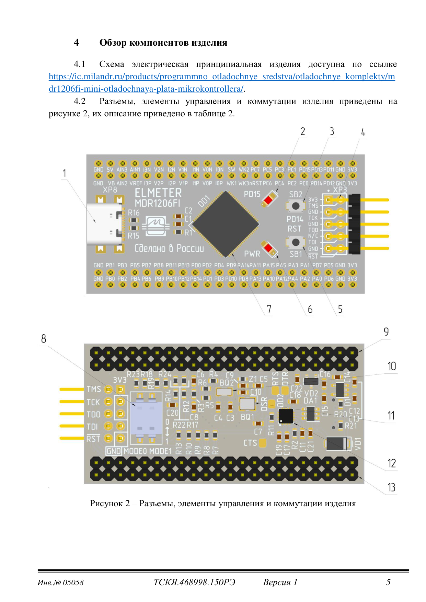
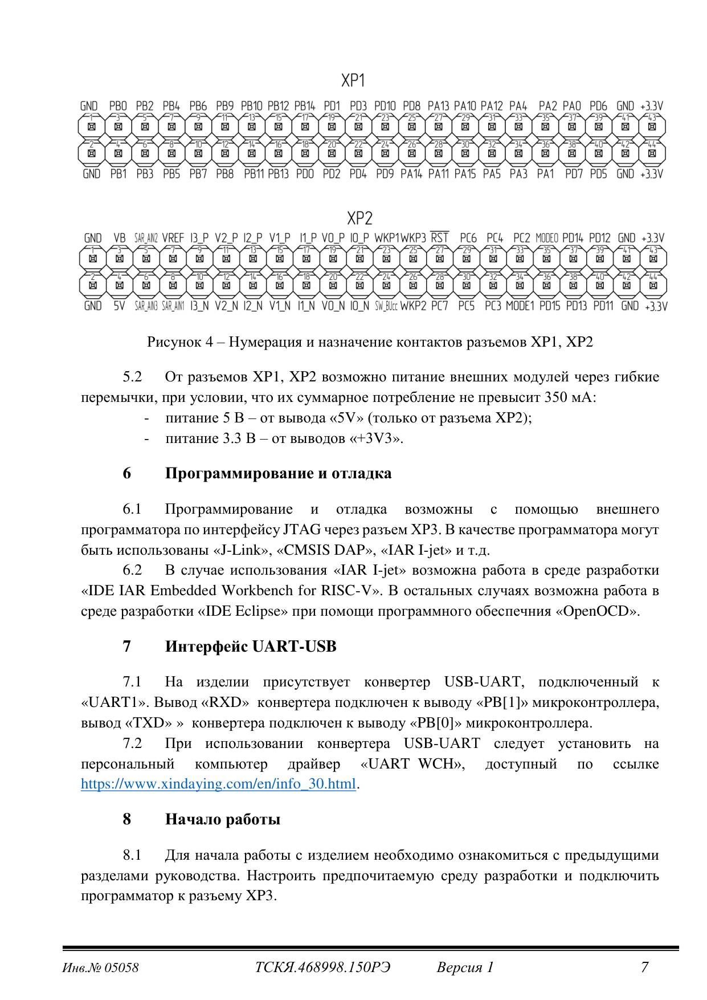
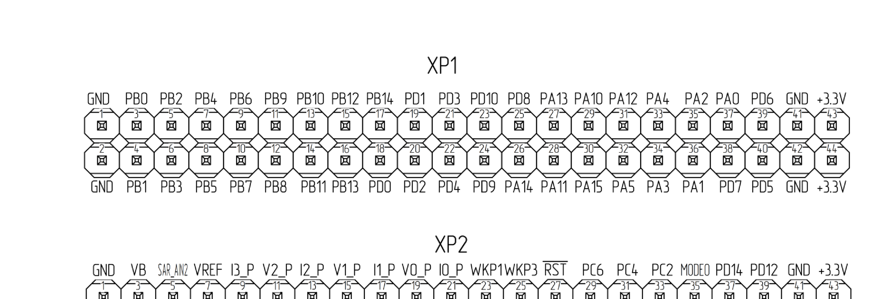
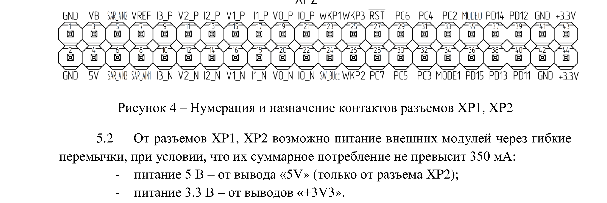
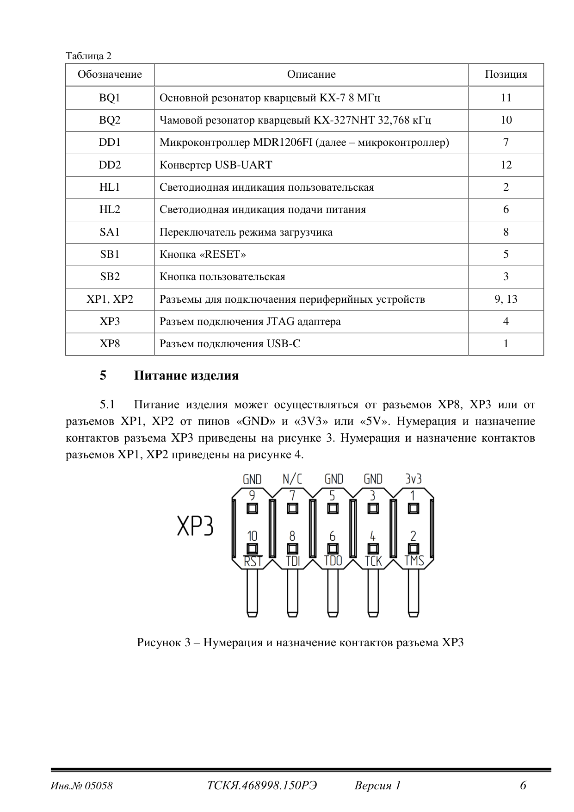
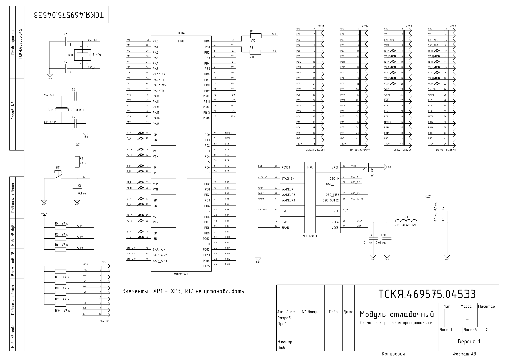
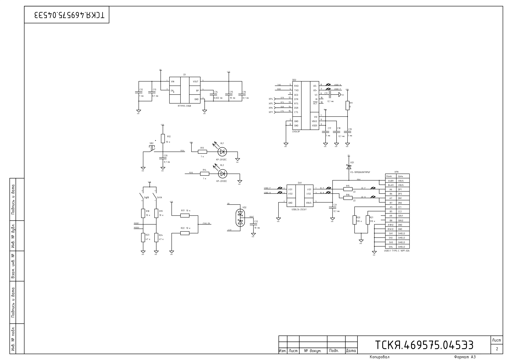

# Отладочная плата MDR1206FI-Mini (ELMETER)

> Разбор отладочной платы **MDR1206FI-Mini** по трём документам:
> - **ТСКЯ.468998.150РЭ** — руководство по эксплуатации, 8 листов, версия 1 (Москва, 2026)
> - **ТСКЯ.469575.045Э3** — схема электрическая принципиальная, 2 листа, формат A3, версия 1
> - **Распиновка MDR1206-Mini** — плакат с назначением выводов
>
> Файлы: `Руководство по эксплуатации MDR1206FI-Mini.pdf`, `Схема электрическая принципиальная MDR1206FI-Mini.pdf`, `Распиновка MDR1206-Mini.pdf`
>
> **Назначение.** Дать агенту всё, что нужно для подключения к плате, прошивки и работы с её периферией — без чтения PDF.

## Содержание

- [1. Основные данные](#1-основные-данные)
- [2. Комплектность](#2-комплектность)
- [3. Обзор компонентов](#3-обзор-компонентов)
- [4. Питание](#4-питание)
- [5. Программирование и отладка](#5-программирование-и-отладка)
- [6. Интерфейс UART-USB](#6-интерфейс-usb-uart)
- [7. Распиновка разъёмов XP1 / XP2](#7-распиновка-разъёмов-xp1--xp2)
- [8. Разъём JTAG XP3](#8-разъём-jtag-xp3)
- [9. Режимы загрузки](#9-режимы-загрузки)
- [10. Схема: узлы и номиналы](#10-схема-узлы-и-номиналы)
- [11. Начало работы](#11-начало-работы)

---

## 1. Основные данные

Плата **MDR1206FI-Mini** (обозначение модуля **ТСКЯ.469575.045**) предназначена для демонстрации работы микросхемы MDR1206FI, обучения программированию и отладки собственных проектов на её основе.

| Параметр | Значение |
|---|---|
| Напряжение питания | **3,3 или 5,0 В** |
| Подключение к ПК | через интерфейс **USB** |
| Температура окружающей среды | **(25 ± 10) °С** |
| Относительная влажность | **45 % … 80 %** |
| Атмосферное давление | **(84,0 … 106,7) кПа** = (630 … 800) мм рт. ст. |

> ⚠️ Температурный диапазон платы — **бытовой, всего ±10 °С от комнатной**. Это отладочная плата, а не промышленное изделие; не использовать её для климатических испытаний.

**Гарантии:** гарантийный срок эксплуатации в пределах гарантийного срока хранения — не менее **6 месяцев**; гарантийный срок хранения с момента отгрузки — **12 месяцев**.

---

## 2. Комплектность

Таблица 1 руководства:

| Обозначение | Наименование | Количество |
|---|---|---|
| ТСКЯ.469575.045 | Модуль отладочный | 1 |
| — | Вилка **DS1021-2x22SF11** | 2 |
| — | Вилка **DS1022-2x5RF11-B** | 1 |

> Допускается замена без уведомления заказчика. Вилки DS1021-2x22 — это и есть разъёмы XP1 и XP2 (2×22 = 44 контакта).

---

## 3. Обзор компонентов

Таблица 2 руководства (с указанием позиции на рисунке 2):

| Обозначение | Описание | Позиция |
|---|---|---|
| **BQ1** | Основной резонатор кварцевый **KX-7 8 МГц** | 11 |
| **BQ2** | Часовой резонатор кварцевый **KX-327NHT 32,768 кГц** | 10 |
| **DD1** | Микроконтроллер **MDR1206FI** | 7 |
| **DD2** | Конвертер **USB-UART** | 12 |
| **HL1** | Светодиодная индикация **пользовательская** | 2 |
| **HL2** | Светодиодная индикация **подачи питания** | 6 |
| **SA1** | **Переключатель режима загрузчика** | 8 |
| **SB1** | Кнопка **«RESET»** | 5 |
| **SB2** | Кнопка **пользовательская** | 3 |
| **XP1, XP2** | Разъёмы для подключения периферийных устройств | 9, 13 |
| **XP3** | Разъём подключения **JTAG** адаптера | 4 |
| **XP8** | Разъём подключения **USB-C** | 1 |

*Разъёмы, элементы управления и коммутации изделия (рисунок 2 руководства).*

> Схема электрическая принципиальная также доступна на сайте производителя:
> <https://ic.milandr.ru/products/programmno_otladochnye_sredstva/otladochnye_komplekty/mdr1206fi-mini-otladochnaya-plata-mikrokontrollera/>

Светодиоды по схеме: **HL1** — `KP-2012EC` через `R13 = 1 к` (пользовательский), **HL2** — `KP-2012EC` через `R14 = 1 к` (питание). Оба на `+3.3V` / `GND`.

---

## 4. Питание

### 4.1. Варианты подачи питания (п. 5.1)

Питание платы может осуществляться:
- от разъёма **XP8** (USB-C),
- от разъёма **XP3** (JTAG),
- от разъёмов **XP1, XP2** — от пинов **«GND»** и **«3V3»** или **«5V»**.

### 4.2. Питание внешних модулей от XP1/XP2 (п. 5.2)

> ⚠️ **Ограничение по току: суммарное потребление внешних модулей не должно превышать 350 мА.**

| Напряжение | Откуда |
|---|---|
| **5 В** | от вывода **«5V»** — **только от разъёма XP2** |
| **3,3 В** | от выводов **«+3V3»** (с обоих разъёмов XP1 и XP2) |

> **«5V» есть только на XP2.** На XP1 вывод 5 В отсутствует. Это важно при разводке внешнего модуля: если ему нужны 5 В, подключать его нужно к XP2.

### 4.3. Преобразователь питания

| Компонент | Тип | Примечание |
|---|---|---|
| **D1** | **RT9193-33GB** | LDO-регулятор 3,3 В: `VIN = 1`, `GND = 2`, `EN = 3` (BP4), `VOUT = 5` |
| **VD1** | VS-10MQ060NTRPbF | Диод Шоттки |
| **VD2** | — | Диоды защиты питания |
| **C12** | 1 мк | Вход LDO |
| **C13** | 0,1 мк | — |
| **C14** | 0,022 мк | — |
| **C15** | 10 мк | Выход LDO |
| **C16** | 0,1 мк | — |
| **C22** | 10 мк | — |

Схема питания: `5V` → **D1 (RT9193-33GB)** → `+3.3V`. Есть также цепь `VBAT`/`VB` с диодами **VD1**, **VD2** — питание батарейного домена микроконтроллера.

---

## 5. Программирование и отладка

### 5.1. Интерфейс (п. 6.1)

Программирование и отладка выполняются **внешним программатором по интерфейсу JTAG** через разъём **XP3**.

Поддерживаемые программаторы:
- **J-Link**
- **CMSIS DAP**
- **IAR I-jet**

### 5.2. Среды разработки (п. 6.2)

| Программатор | Среда |
|---|---|
| **IAR I-jet** | «IDE **IAR Embedded Workbench for RISC-V**» |
| Остальные (J-Link, CMSIS DAP) | «IDE **Eclipse**» + **OpenOCD** |

> ⚠️ Для работы с Eclipse нужен **OpenOCD с поддержкой MDR1206FI**. Стандартная сборка OpenOCD эту микросхему не знает — нужен пропатченный вариант (это же требование указано в readme демо-проектов, см. [EXAMPLES.md](EXAMPLES.md)).

### 5.3. Цепи JTAG на схеме

Разъём **XP3** типа **PLD-10R**, сигналы:

| Цепь | Назначение |
|---|---|
| `TMS` | JTAG TMS |
| `TCK` | JTAG TCK |
| `TDO` | JTAG TDO |
| `TDI` | JTAG TDI |
| `RST` | Сброс |
| `+3.3V`, `GND` | Питание |

Каждая из линий **TMS, TCK, TDO, TDI, RST** подключена через резистор **47 к** (`R7`, `R8`, `R9`, `R10`, `R5`, `R6`) — типовые подтяжки JTAG.

Резистор **R17 = 10 к** — подтяжка линии **`JTAG_EN`**. Резисторы **R18, R19 = 10 к**, **R22 = 10 к** — подтяжки цепей `MODE0`/`MODE1` и связанных сигналов.

> **Важно про `JTAG_EN` (вывод 60 микросхемы).** По спецификации: `1` — boundary scan (выводы PB[9:6]), `0` — JTAG-интерфейс RISC-V (выводы PA[9:6]). На этой плате линия подтянута (R17), то есть режим зафиксирован — сверять с реальным монтажом платы, если JTAG не отвечает.

---

## 6. Интерфейс USB-UART

### 6.1. Подключение (п. 7.1)

На плате присутствует конвертер **USB-UART**, подключённый к **UART1** микроконтроллера:

| Сигнал конвертера | Вывод микроконтроллера |
|---|---|
| **RXD** конвертера | **PB[1]** (UART1_RXD) |
| **TXD** конвертера | **PB[0]** (UART1_TXD) |

То есть `PB[0]` (UART1_TXD МК) → RXD конвертера, `PB[1]` (UART1_RXD МК) → TXD конвертера. Классическая перекрёстная схема.

На схеме видны резисторы **R1 = 470**, **R2 = 470** между сигналами `TXD`/`RXD` и выводами `PB0`/`PB1` — токоограничивающие.

### 6.2. Микросхема конвертера

**DD2 = CH343P** (WCH). На схеме подключены линии: `UD-`, `UD+`, `VBUS`, `V33`, `VIO`, `ACT`, а также полный набор модемных сигналов — **`RI`, `RXD`, `TXD`, `RTS`, `DSR`, `CTS`, `DTR`, `DCD`**.

Цепи USB: **XP8** — USB 3.1 Type-C 16PF-026, через защиту **DA1 = USBLC6-2SC6Y** (ESD-защита), резисторы **R15, R16 = 22** (согласование), **R20, R21 = 510 к** (подтяжки CC).

### 6.3. Драйвер (п. 7.2)

> ⚠️ Требуется установить драйвер **«UART WCH»** на ПК: <https://www.xindaying.com/en/info_30.html>

### 6.4. Параметры по умолчанию

Демонстрационный проект для этой платы использует **9600 бод, 8 бит данных, 1 стоп-бит, без чётности** (см. [EXAMPLES.md](EXAMPLES.md)). Это совпадает с параметрами режима загрузки UART+J по умолчанию.

---

## 7. Распиновка разъёмов XP1 / XP2

Разъёмы **XP1** и **XP2** — типа **DS1021-2x22SF11** (2 ряда × 22 контакта = **44 вывода**), обозначены на схеме как `XP1A`/`XP1B` и `XP2A`/`XP2B` (два ряда каждого разъёма).

**Схема нумерации:** нечётные выводы (1, 3, 5, …, 43) — **верхний ряд**, чётные (2, 4, 6, …, 44) — **нижний ряд**. Источник: рисунок 4 руководства и схема Э3.

*Рисунок 4 руководства: нумерация и назначение контактов XP1, XP2.*

Крупные фрагменты рисунка — для чтения мелких подписей:

### 7.1. XP1 — цифровая периферия

| Вывод | Верхний ряд (нечётные) | Вывод | Нижний ряд (чётные) |
|---|---|---|---|
| 1 | GND | 2 | GND |
| 3 | PB0 | 4 | PB1 |
| 5 | PB2 | 6 | PB3 |
| 7 | PB4 | 8 | PB5 |
| 9 | PB6 | 10 | PB7 |
| 11 | PB9 | 12 | PB8 |
| 13 | PB10 | 14 | PB11 |
| 15 | PB12 | 16 | PB13 |
| 17 | PB14 | 18 | PD0 |
| 19 | PD1 | 20 | PD2 |
| 21 | PD3 | 22 | PD4 |
| 23 | PD10 | 24 | PD9 |
| 25 | PD8 | 26 | PA14 |
| 27 | PA13 | 28 | PA11 |
| 29 | PA10 | 30 | PA15 |
| 31 | PA12 | 32 | PA5 |
| 33 | PA4 | 34 | PA3 |
| 35 | PA2 | 36 | PA1 |
| 37 | PA0 | 38 | PD7 |
| 39 | PD6 | 40 | PD5 |
| 41 | GND | 42 | GND |
| 43 | +3.3V | 44 | +3.3V |

> ⚠️ **Порядок выводов неочевиден и не соответствует возрастанию номеров портов.** `PB9` (11) стоит перед `PB8` (12); `PD10` (23), `PD9` (24), `PD8` (25) — перед `PD5` (40). Это следствие того, как порты разведены на корпус микросхемы (см. [MDR1206FI.md, раздел 2.1](MDR1206FI.md#21-таблица-выводов-mdr1206fi--mdr1206afi-таблица-1)) — не опечатка. Всегда сверяться с таблицей.
>
> ⚠️ На XP1 **нет вывода 5 В** — только `+3.3V` и `GND`.

### 7.2. XP2 — аналоговая периферия и питание

| Вывод | Верхний ряд (нечётные) | Вывод | Нижний ряд (чётные) |
|---|---|---|---|
| 1 | GND | 2 | GND |
| 3 | VB | 4 | 5V |
| 5 | SAR_AIN2 | 6 | SAR_AIN3 |
| 7 | VREF | 8 | SAR_AIN1 |
| 9 | I3_P | 10 | I3_N |
| 11 | V2_P | 12 | V2_N |
| 13 | I2_P | 14 | I2_N |
| 15 | V1_P | 16 | V1_N |
| 17 | I1_P | 18 | I1_N |
| 19 | V0_P | 20 | V0_N |
| 21 | I0_P | 22 | I0_N |
| 23 | WKP1 | 24 | SW |
| 25 | WKP3 | 26 | WKP2 |
| 27 | RST | 28 | PC7 |
| 29 | PC6 | 30 | PC5 |
| 31 | PC4 | 32 | PC3 |
| 33 | PC2 | 34 | MODE1 |
| 35 | MODE0 | 36 | PD15 |
| 37 | PD14 | 38 | PD13 |
| 39 | PD12 | 40 | PD11 |
| 41 | GND | 42 | GND |
| 43 | +3.3V | 44 | +3.3V |

> ⚠️ **Метка `SW` (вывод 24) в PDF читается нечётко** — в разных рендерах рисунка она выглядит как `SW_BUcc` или `SW_BUtt`. По схеме Э3 цепь называется **`SW_BUcc`** и соединена с выводом **`SW`** микросхемы (вывод 64) — это выход управления внешним переключателем питания UCCB на UCC. Считать, что назначение вывода — **`SW`**, а `SW_BUcc` — имя цепи на схеме.
>
> ⚠️ **`5V` есть только на XP2** (вывод 4). См. раздел 4.2.

### 7.3. Сводка соответствия «вывод разъёма → функция»

Значения функций — из таблицы мультиплексирования спецификации ([MDR1206FI.md, раздел 2.2](MDR1206FI.md#22-функции-выводов-портов-таблица-2-с-2631)). Плакат распиновки подписывает каждый вывод всеми доступными функциями.

**Цифровые выводы на XP1:**

| Вывод МК | Основная | Альтернативная | Переопределённая |
|---|---|---|---|
| PB0 | UART1_TXD | UART7816_TXD | TMR3_CH1 |
| PB1 | UART1_RXD | UART7816_RXD | TMR3_CH1N |
| PB2 | nSIROUT1 | UART7816_CLK | TMR3_CH2 |
| PB3 | nSIRIN1 | UART7816_CTS | TMR3_CH2N |
| PB4 | nUART1DTR | — | TMR3_CH3 |
| PB5 | nUART1RTS | UART7816_RTS | TMR3_CH3N |
| PB6 | nUART1RI | EXT_INT2 | TMR3_CH4 |
| PB7 | nUART1DCD | EXT_INT3 | TMR3_CH4N |
| PB8 | nUART1DSR | TMR2_ETR | TMR3_ETR |
| PB9 | nUART1CTS | TMR2_BRK | TMR3_BRK |
| PB10 | TMR2_CH2 | UART4_RXD | — |
| PB11 | TMR2_CH2N | UART4_TXD | — |
| PB12 | TMR2_CH3 | — | — |
| PB13 | TMR2_CH3N | UART2_TXD | — |
| PB14 | TMR2_CH4 | UART2_RXD | — |
| PD0 | SSP2_FSS | SD_V0_EXT | — |
| PD1 | SSP2_CLK | SD_V1_EXT | — |
| PD2 | SSP2_RXD | SD_V2_EXT | — |
| PD3 | SSP2_TXD | — | — |
| PD4 | UART2_TXD | — | — |
| PD5 | UART2_RXD | — | — |
| PD6 | UART3_RXD | — | — |
| PD7 | UART3_TXD | — | — |
| PD8 | UART4_RXD | — | — |
| PD9 | UART4_TXD | — | — |
| PD10 | UART7816_TXD | SD_I0_EXT | — |
| PA0 | TMR1_CH1 | SSP2_FSS | — |
| PA1 | TMR1_CH1N | SSP2_CLK | — |
| PA2 | TMR1_CH2 | SSP2_RXD | — |
| PA3 | TMR1_CH2N | SSP2_TXD | — |
| PA4 | TMR1_CH3 | — | — |
| PA5 | TMR1_CH3N | — | — |
| PA10 | EXT_INT1 | UART3_RXD | TMR4_CH1 |
| PA11 | TMR2_CH4N | UART3_TXD | TMR4_CH1N |
| PA12 | SSP1_FSS | — | TMR4_CH2 |
| PA13 | SSP1_CLK | — | TMR4_CH2N |
| PA14 | SSP1_RXD | — | TMR4_CH3 |
| PA15 | SSP1_TXD | — | TMR4_CH3N |

**Выводы на XP2:**

| Вывод МК | Основная | Альтернативная | Переопределённая |
|---|---|---|---|
| PC2 | TMR2_CH1 | SSP3_FSS | **I2C1_SCL** |
| PC3 | TMR2_CH1N | SSP3_CLK | **I2C1_SDA** |
| PC4 | EXT_INT2 | SSP3_RXD | — |
| PC5 | EXT_INT3 | SSP3_TXD | — |
| PC6 | TMR2_ETR | **I2C1_SCL** | — |
| PC7 | TMR2_BRK | **I2C1_SDA** | — |
| PC0/MODE0 | TMR4_ETR | — | TMR4_CH4 |
| PC1/MODE1 | TMR4_BRK | — | TMR4_CH4N |
| PD11 | UART7816_RXD | SD_I1_EXT | — |
| PD12 | UART7816_CLK | SD_I2_EXT | — |
| PD13 | UART7816_CTS | SD_I3_EXT | — |
| PD14 | UART7816_RTS | CLK_SD_EXT | — |
| PD15 | EXT_INT1 | RTCCLK_1Hz | — |

**Аналоговые выводы на XP2** (только аналоговая функция, `MODE = 00`, `ANALOG_EN = 0`):

| Вывод МК | Сигнал |
|---|---|
| I0P (69) / I0N (70) | Канал тока 0 |
| V0P (71) / V0N (72) | Канал напряжения 0 |
| I1P (73) / I1N (74) | Канал тока 1 |
| V1P (75) / V1N (76) | Канал напряжения 1 |
| I2P (77) / I2N (78) | Канал тока 2 |
| V2P (79) / V2N (80) | Канал напряжения 2 |
| I3P (81) / I3N (82) | Канал тока 3 |
| VREF (83) | Опорное напряжение 2,4 В |
| SAR_AIN1 (84) | Вход 1 SAR АЦП |
| SAR_AIN2 (85) | Вход 2 SAR АЦП |
| SAR_AIN3 (86) | Вход 3 SAR АЦП |

> **Плата разведена под счётчик электроэнергии.** На XP2 выведены все четыре канала тока (`I0`…`I3`) и три канала напряжения (`V0`…`V2`) — это позволяет собрать как трёхфазный счётчик, так и однофазный с дополнительными каналами. См. типовые схемы включения в спецификации (с. 164, 166, 167).

**Цепи `SD_*_EXT`** (`SD_V0_EXT`…`SD_I3_EXT`) и **`CLK_SD_EXT`** — это переопределённые функции выводов PD0…PD14, предназначенные для внешнего подключения сигма-дельта модуляторов. На плате они выведены на XP1 (PD0, PD1, PD2, PD10) и XP2 (PD11…PD14).

**Прочие цепи на XP2:**

| Цепь | Назначение |
|---|---|
| `VB` (вывод 3) | Напряжение батареи (батарейный домен) |
| `WKP1` (23), `WKP2` (26), `WKP3` (25) | Входы сигналов вскрытия WAKEUP1 (63), WAKEUP2 (62), WAKEUP3 (61) |
| `SW` (24) | Выход управления переключением питания UCCB → UCC (вывод 64) |
| `RST` (27) | Сигнал сброса nRESET (вывод 59) |

> ⚠️ **`WKP1`/`WKP2`/`WKP3` — не GPIO, а отдельные входы детектора вскрытия** (tamper). Их нельзя использовать как обычные входы: они работают специфическим образом, в том числе способны фиксировать событие в батарейном домене.

---

## 8. Разъём JTAG XP3

*Рисунок 3 руководства: нумерация и назначение контактов XP3.*

Разъём **XP3** типа **PLD-10R**, 10 контактов — **двухрядный** (2 × 5), нумерация по рисунку 3 руководства:

| Контакт | Цепь | | Контакт | Цепь |
|---|---|---|---|---|
| **1** | `+3.3V` | | **2** | `TMS` |
| **3** | `GND` | | **4** | `TCK` |
| **5** | `GND` | | **6** | `TDO` |
| **7** | `GND` | | **8** | `TDI` |
| **9** | `GND` | | **10** | `RST` |
| — | | | — | **`N/C`** — свободный контакт |

Разложение по рядам:

| Ряд | Контакты |
|---|---|
| Нечётный | 1 = `+3.3V`, 3 = `GND`, 5 = `GND`, 7 = `GND`, 9 = `GND` |
| Чётный | 2 = `TMS`, 4 = `TCK`, 6 = `TDO`, 8 = `TDI`, 10 = `RST` |

> **Здесь легко ошибиться.** Состав цепей подтверждён двумя источниками: рисунком 3 руководства (с. 6) и схемой Э3 — `TMS`, `TCK`, `TDO`, `TDI`, `RST`, `+3.3V` и **четыре** `GND`. Обратите внимание:
> - питание `+3.3V` — только на **контакте 1**, единственном;
> - **на разъёме нет контакта `N/C`** — обозначение `N/C` на рисунке относится к незадействованному **паяльному полю/экрану**, а не к десятому контакту;
> - `GND` занимает **четыре** контакта (3, 5, 7, 9);
> - `RST` — на **контакте 10**.
>
> Ранее в этом документе таблица контактов была приведена неверно (цепь `N/C` приписывалась контакту 10, а `RST` — контакту 9, `GND` — контактам 3, 5, 7). Значения выше — исправленные, сверенные с двумя источниками.

> ⚠️ **Назначение контактов 9 vs 10 стоит перепроверить при первом подключении** (мультиметром: прозвонка `GND` и `RST`). Рисунок в руководстве мелкий, а ошибка здесь означает подачу 3,3 В на цепь сброса вместо земли. Состав цепей достоверен; именно привязка «9 = GND, 10 = RST» — наименее надёжная часть рисунка.

---

## 9. Режимы загрузки

На плате есть **переключатель режима загрузчика SA1**, который через резисторы `R17`, `R18`, `R19`, `R22` управляет линиями **`MODE0`** (= `PC0`) и **`MODE1`** (= `PC1`).

Таблица режимов (с плаката распиновки; полностью совпадает с Таблицей 8 спецификации):

| MODE0 | MODE1 | Режим | Стартовый адрес |
|---|---|---|---|
| 0 | 0 | **FLASH+J** | `0x10000000` |
| 0 | 1 | **UART+J** | определяется пользователем |
| 1 | 0 | **UART+J** | определяется пользователем |
| 1 | 1 | **RAM+J** | `0x40000000` |

Подробнее о режимах — в [MDR1206FI.md, раздел 6](MDR1206FI.md#6-режимы-запуска).

> ⚠️ **Очень важная ловушка, связанная с этой платой.** Переключатель SA1 действует **только при первом включении** микросхемы. После успешной работы загрузочной программы устанавливается бит **`FPOR`** в регистре `BKP_LDO`, и при последующих перезапусках режим запуска читается **из бит `MODE[1:0]` регистра `BKP_LDO`**, а не с выводов.
>
> **Практическое следствие:** переставили переключатель, нажали RESET — режим не сменился, потому что `FPOR` уже установлен. Чтобы переключение сработало, нужно сбросить батарейный домен (или микросхему целиком, вместе с батарейным питанием). Это самая частая причина «переключатель не работает» на этой плате.

---

## 10. Схема: узлы и номиналы

*Схема Э3 ТСКЯ.469575.045Э3, лист 1.*

*Схема Э3 ТСКЯ.469575.045Э3, лист 2.*

Схема Э3, лист 1 (обозначение **ТСКЯ.469575.045Э3**). Номиналы из выгрузки:

> Дополнительно: [фрагмент с разъёмами XP1/XP2](assets/board-schematic-connectors.png), [фрагмент с микроконтроллером DD1](assets/board-schematic-mcu.png), [плакат распиновки](assets/board-pinout.png).

### 10.1. Генераторы

| Цепь | Компоненты |
|---|---|
| **HSE (8 МГц)** | `BQ1` = KX-7 8 МГц; `C1 = 12`, `C2 = 12` (нагрузочные ёмкости) |
| **LSE (32,768 кГц)** | `BQ2` = KX-327NHT 32,768 кГц; `C3`, `C4` (нагрузочные ёмкости) |

> Соответствует рекомендациям спецификации: суммарная нагрузочная ёмкость **24 пФ для 8 МГц** → два конденсатора по 12 пФ как раз дают эту сумму вместе с паразитной ёмкостью платы. Для LSE рекомендация — **8…12 пФ** (см. [MDR1206FI.md, раздел 9](MDR1206FI.md#9-тактирование)).

### 10.2. Питание и фильтрация

| Компонент | Номинал | Назначение |
|---|---|---|
| `C5`, `C6`, `C7`, `C8`, `C9` | 0,1 мк | Развязка по питанию |
| `C10` | 0,01 мк | Развязка |
| `C11`, `C13`, `C16`, `C18`, `C20`, `C21` | 0,1 мк | Развязка |
| `C12`, `C17`, `C19` | 1 мк | — |
| `C14` | 0,022 мк | — |
| `C15`, `C22` | 10 мк | — |
| **`Z1`** | **BLM18AG601SN1D** | Ферритовая бусина (фильтр по `VCCA`) |

> `Z1` на линии `VCCA` — ровно то, что требует спецификация: «на печатной плате должны быть применены меры по снижению наводки помех» для аналогового питания (см. [MDR1206FI.md, раздел 5.1](MDR1206FI.md#51-типы-выводов-питания-с-36)).

### 10.3. Подтяжки

| Резистор | Номинал | Цепь |
|---|---|---|
| `R3` | 47 к | `RST` |
| `R4`, `R5`, `R6` | 47 к | Подтяжки JTAG / `VAKEUP` |
| `R7`–`R10` | 47 к | JTAG (TMS, TCK, TDO, TDI) |
| `R12` | 10 к | — |
| `R17`, `R22` | 10 к | `JTAG_EN` / служебные |
| `R18`, `R19` | 10 к | — |
| `R13`, `R14` | 1 к | Светодиоды `HL1`, `HL2` |
| `R23`, `R24` | 47 к | `MODE0`, `MODE1` |
| `R15`, `R16` | 22 | USB D+/D− согласование |
| `R20`, `R21` | 510 к | USB Type-C CC1/CC2 |
| `R1`, `R2` | 470 | Линии `TXD`/`RXD` UART |
| `R11` | 0 | Перемычка |

> **Обратите внимание на разницу номиналов подтяжек MODE:** `R23`, `R24 = 47 к` в одной части схемы и `R18`, `R19 = 10 к` — в другой. Соответствует тому, что выводы MODE[1:0] имеют **внутреннюю подтяжку pull-down** (см. [MDR1206FI.md, раздел 6.1](MDR1206FI.md#61-как-определяется-режим-запуска)).

### 10.4. USB-UART конвертер

**DD2 = CH343P** — мост USB ↔ UART. Подключены сигналы:
- USB: `UD-`, `UD+`, `VBUS`, `V33`, `VIO`
- UART: `TXD`, `RXD`, `RTS`, `CTS`, `DTR`, `DSR`, `RI`, `DCD`
- `ACT` — индикация активности

> ⚠️ **Полный набор модемных линий подключён** (`RTS`, `CTS`, `DTR`, `DSR`, `RI`, `DCD`). Их можно задействовать при разработке, если включить соответствующие альтернативные функции на PB4…PB9 (см. таблицу в разделе 7.3). На схеме также присутствуют разъёмы **XP4, XP5, XP6, XP7** для этих цепей.

---

## 11. Начало работы

Порядок по п. 8.1 руководства:

1. Ознакомиться с предыдущими разделами руководства.
2. Настроить предпочитаемую среду разработки.
3. Подключить программатор к разъёму **XP3**.

**Расширенный порядок для Eclipse** (из readme демо-проектов, см. [EXAMPLES.md](EXAMPLES.md)):

1. Настроить окружение: **IDE Eclipse**, тулчейн **RISC-V GCC**, **пропатченный OpenOCD** с поддержкой MDR1206FI.
2. Импортировать проект в workspace и собрать.
3. Подключить **USB-кабель** к плате и ПК — плата питается по USB.
4. Подключить отладчик **CMSIS-DAP** (или внести правки в конфигурации отладки Eclipse при использовании другого).
5. Запустить нужную конфигурацию отладки из `launch_cfg/`.
6. Установить драйвер **«UART WCH»** для работы с USB-UART.

### Чек-лист типовых проблем

| Симптом | Вероятная причина |
|---|---|
| Отладчик не подключается | OpenOCD не пропатчен под MDR1206FI; либо линия `JTAG_EN` (вывод 60) в неподходящем состоянии |
| Переключатель режима загрузки не действует | Установлен бит `FPOR` в `BKP_LDO` — режим читается из регистра, а не с выводов. Нужен сброс батарейного домена |
| Переставили переключатель, но UART-загрузчик не отвечает | Проверить, что SA1 действительно меняет уровни на `MODE0`/`MODE1`, и что скорость терминала 9600 бод |
| COM-порт не появляется | Не установлен драйвер «UART WCH» |
| Светодиод питания не горит | Нет питания по USB; проверить `VD1`/`VD2` и LDO `D1` (RT9193-33GB) |
| JTAG работает, но не видит выводы PA6–PA9 | Эти выводы совмещены с JTAG. При разрешённом JTAG их использование как Timer 1 **не допускается**, и бит 6 `PORT_RXTX` порта A всегда равен «0» |

---

## Связанные документы

- Справочник по микроконтроллеру: [MDR1206FI.md](MDR1206FI.md)
- Примеры проектов: [EXAMPLES.md](EXAMPLES.md)
- Исходные PDF: каталог каталог с исходными архивами